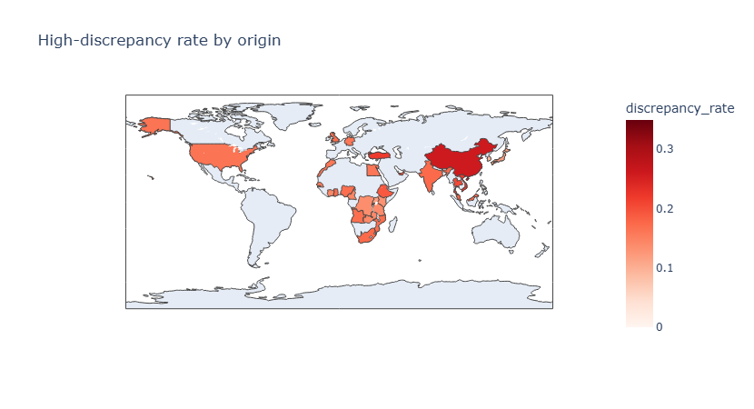

# Customs Risk Predictive Project

Predictive risk scoring on synthetic customs clearance data (5,250 shipments, MEA region;
4,746 after cleaning): which shipments are likely to clear slowly, and which are likely to be
under-declared.

Status: in progress. Built step by step alongside a machine learning course.
Current stage: exploratory analysis and interactive maps complete. Next: significance tests and a
feature shortlist, then train/test design and models.
Progress, decisions and findings are logged in PROJECT_LOG.md.

## What is here so far
- `01_Data_Cleaning.ipynb`: cleaning of the raw file (5,250 to 4,746 rows)
- `02_Feature_Engineering.ipynb`: time features, licence flag, valuation-gap target
- `03_EDA.ipynb`: exploratory charts (saved in `images/`)
- `03b_Interactive_Maps.ipynb`: interactive port and origin charts and maps (plotly)
- `environment.yml`: conda environment
- `PROJECT_LOG.md`: dated record of steps, numbers and decisions

## Early findings (exploratory, not yet tested)
- About 26% of shipments clear slowly and 18% show a large valuation discrepancy, so accuracy would
  be a misleading measure and models are judged against these base rates.
- Slow clearance is driven mainly by port and weekend entry. The four busiest ports run slow
  30% to 34% of the time, against 13% to 21% for the other eight.
- Valuation discrepancy varies most by origin (9% to 26% across 29 origins), then by product type
  and supplier, and not by port. Origin differences on the smaller origins are noisy.
- Weight, volume and broker fee show almost no link to slow clearance.

